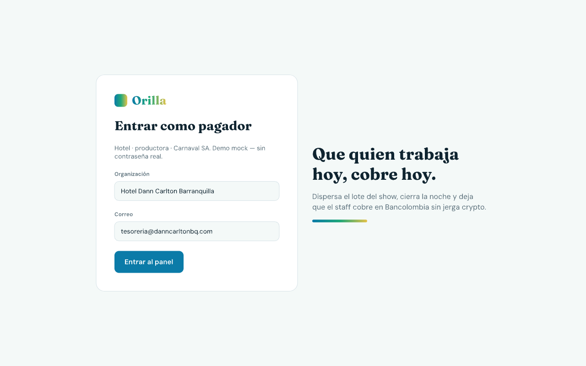
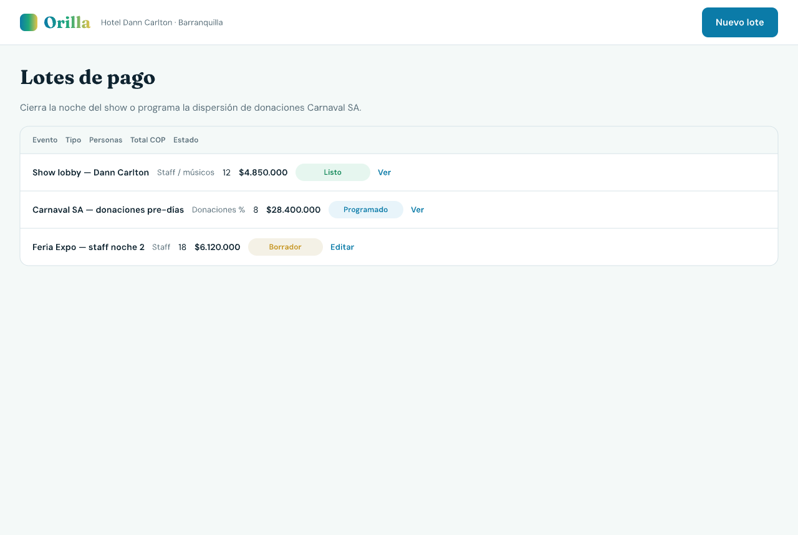
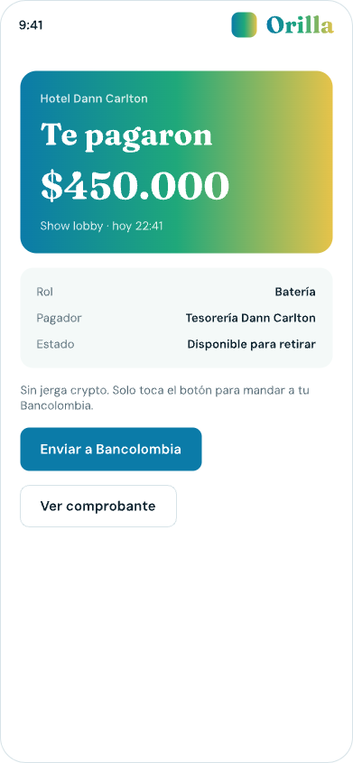
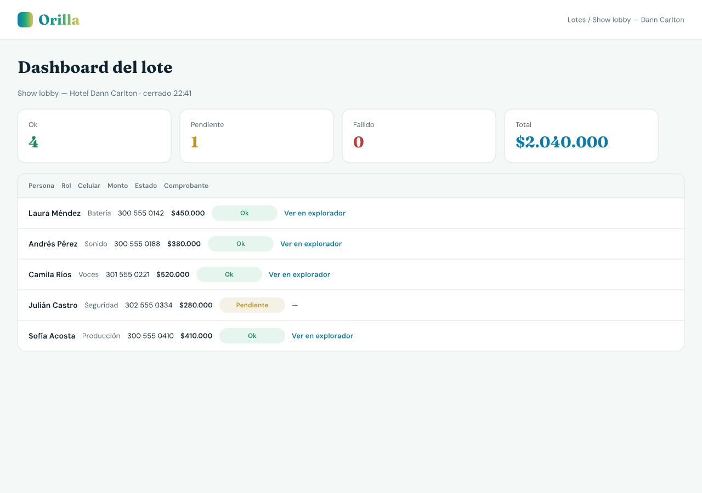
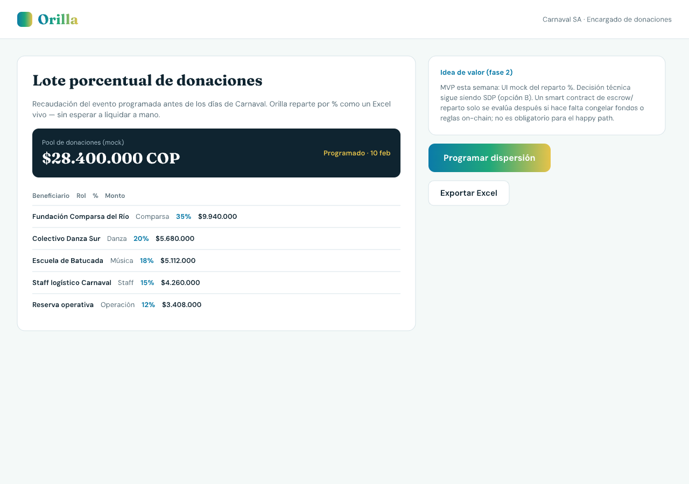
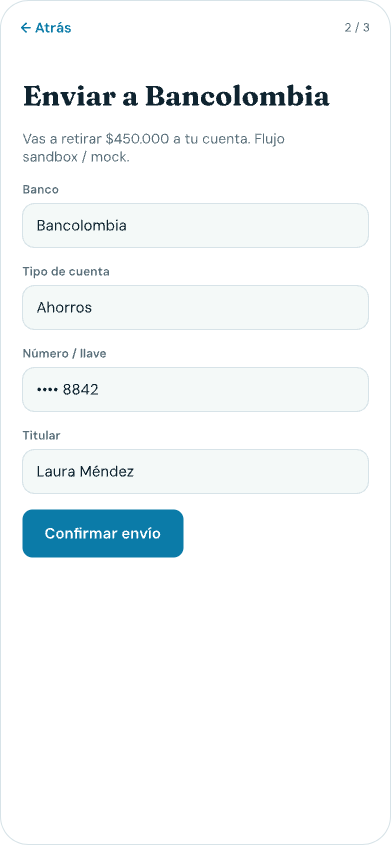

# Entregable 3 — Functional Proof · Orilla

**Equipo:** bb101-caribe-lab  
**Producto:** Orilla — *Que quien trabaja hoy, cobre hoy.*  
**Repositorio:** [bb101-caribe-lab](https://github.com/Jgmaza/bb101-caribe-lab)  
**Front:** carpeta `frontend/` (Next.js + Tailwind, datos mock)  
**Diseño fuente:** `frontend/orilla.pen` (Pen.dev)

---

## 1. Front construido

Esta semana el equipo materializó la interfaz del flujo principal del MVP definido en el Product Blueprint (`docs/semana2/ProductBlueprint.md`). El front es una webapp única (pensada para poder convertirse en PWA más adelante, sin app nativa todavía): el **pagador** opera desktop-first y el **trabajador / músico / staff** opera mobile-first. No hay smart contracts ni SDP conectados en esta entrega; todo corre con datos mock para demostrar el recorrido visual y la promesa de producto.

### Conexión con el MVP del Blueprint

El Blueprint prioriza el happy path: pagador lanza lote → trabajador ve el pago → cash-out a Bancolombia. Las pantallas implementadas cubren ese ciclo y el backlog US-1 a US-8 a nivel de UX:

| Pantalla / ruta | Historia / paso del Blueprint | Rol |
| --- | --- | :---: |
| `/pagador/login` | Entrada fake a tesorería (hotel / productora) | Pagador |
| `/pagador/lotes` | Lista de lotes y estados | Pagador |
| `/pagador/lotes/nuevo` | Carga de lista / CSV + preview de receptores | Pagador (US-3) |
| `/pagador/lotes/[id]/cerrar` | Confirmación **Cerrar la noche** | Pagador |
| `/pagador/lotes/[id]` | Dashboard ok / pendiente / fallido + comprobantes | Pagador (US-6, US-7) |
| `/pagador/lotes/carnaval` | Lote porcentual de donaciones (idea de valor fase 2) | Pagador |
| `/cobrar/[token]` | Onboarding ≤ 3 pasos + OTP mock | Trabajador (US-5, US-8) |
| `/cobrar/[token]/pago` | **Te pagaron $X** + saldo Orilla | Trabajador (US-2, US-4) |
| `/cobrar/[token]/banco` | **Enviar a Bancolombia** | Trabajador (US-1) |
| `/cobrar/[token]/exito` | Confirmación sandbox del retiro | Trabajador |
| `/cobrar/[token]/comprobante` | Comprobante + enlace a explorador Stellar (testnet) | Trabajador (US-7) |

Casos demo embebidos: **Hotel Dann Carlton Barranquilla** (show lobby con staff/músicos) y **Carnaval SA** (donaciones programadas antes de los días de Carnaval).

### Modelo mental de tres eslabones (UX)

Para no empujar jerga crypto al usuario héroe, el front trata la wallet Stellar como **subfondo**:

1. El pagador **cierra la noche** (dispara el lote).  
2. El trabajador ve el dinero en su **saldo Orilla** (contenedor temporal; wallet debajo).  
3. Envía a **Bancolombia** (plata usable).

Stellar aparece de forma suave en el comprobante (*“Pago registrado en Stellar (testnet)”*), no como identidad principal del músico.

### Identidad visual

Fondo blanco / soft Caribbean, acentos azul `#0B7BA8`, verde `#1FA87A` y arena `#E6C34A`. Tipografía: **Fraunces** (marca y títulos) + **DM Sans** (UI). Logo Orilla con degradado de los tres colores. Se evitaron morados asociados a apps de consumo (Nequi/Nu). Referencia de panel de dispersión: [Sozu Pay](https://pay.sozu.capital) (estructura de producto, no el estilo visual).

### Capturas













Diseño completo en Pen: `frontend/orilla.pen`. Exports adicionales: `frontend/design-exports/`.

### Cómo recorrer el front

```bash
cd frontend && npm install && npm run dev
```

Abrir `http://localhost:3000`. Staff demo: `/cobrar/laura` con OTP mock `4821`.

Si el proyecto queda hosteado en Vercel, el enlace público se registra en el campo Website de Apex.

### Idea de valor propuesta: donaciones porcentuales (Carnaval SA)

Además del happy path hotel → músico, el front incluye una pantalla de **lote porcentual de donaciones** orientada a un encargado de Carnaval SA que recibe aportes de un evento y debe repartirlos **por porcentaje** a comparsas, escuelas, staff y reserva operativa, programado con tiempo antes de los días de Carnaval.

**Qué problema ataca.** Hoy ese reparto vive en Excel, chats y transferencias manuales. El riesgo no es solo “tardanza”: es opacidad (“¿ya me tocó mi %?”), errores de cálculo y presión operativa en la semana pico. Orilla puede presentar el pool recaudado, la tabla de % y el monto resultante por beneficiario, y programar la dispersión como un lote más.

**Viabilidad en el MVP actual.** Esta semana la pantalla es **mock de propuesta de valor**: demuestra el concepto sin backend ni contratos. Encaja con la arquitectura ya elegida (lista → dispersión masiva → comprobante), solo cambia la forma de calcular montos (porcentaje sobre un pool en lugar de fila fija por persona).

**¿Hace falta smart contract?** No de entrada. Mientras el pagador controle el fondeo y Orilla/SDP ejecute pagos a wallets o cuentas destino, un contrato propio no aporta al demo. Un contrato (escrow, reglas de % on-chain, liberación condicionada) tendría sentido **después**, si se necesita congelar donaciones, impedir que el encargado altere el reparto a última hora, o publicar reglas auditables a la comunidad. Eso es fase 2: más compliance, más producto y más superficie de ataque. Para el bootcamp, la decisión sigue siendo **SDP / ecosistema (opción B)**; el lote % se documenta como extensión de valor, no como cambio de arquitectura de esta semana.

**Riesgos a vigilar.** (1) Cumplimiento y KYC si hay donaciones reales. (2) Definición legal de “encargado” vs tesorería del Carnaval. (3) Disputas si el pool cambia después de programar. (4) UX: el beneficiario debe entender “te tocó X% del evento” igual de claro que “te pagaron $X del show”. Ninguno de estos bloquea el mock; todos condicionan un piloto real.

En conjunto, la idea fortalece la narrativa Caribe (Carnaval + hotel) sin desviarnos del MVP: **velocidad y dignidad de pago**, con trazabilidad como subproducto.

---

## 2. Decisión técnica

**Opción elegida: B — Solución existente del ecosistema (Stellar Disbursement Platform y rails asociados).**

### Qué usaremos

- **Stellar Disbursement Platform (SDP)** para dispersar el lote a muchos receivers en testnet.  
- **Pagos en asset estable (USDC u asset de testnet)** para mover valor al trabajador.  
- **Wallet on-demand / deep link** para que el receptor cobre sin cuenta crypto previa (en UI: “saldo Orilla”).  
- **Ancla / partner off-ramp (sandbox en MVP)** para el flujo “Enviar a Bancolombia”.  
- **Explorador / hash de transacción** como comprobante verificable.

Esto replica la sección “Uso de Stellar” del Product Blueprint: Stellar entra cuando hay que **pagar de verdad** y dejar un registro compartido, no como base de datos cosmética de eventos.

### Por qué B y no A (contrato propio)

1. El dolor del MVP es **dispersión masiva + llegada a banco**, no una lógica on-chain novedosa. SDP ya resuelve colas, registro de receivers y pagos batch.  
2. Un contrato propio retrasaría la demo sin mejorar la fibra del músico (“te pagaron” → Bancolombia).  
3. Off-ramp y compliance bancario viven fuera de un contrato casero; conviene partner/ancla.  
4. La idea de donaciones % **tampoco exige** contrato esta semana: el cálculo puede ser off-chain y la liquidación vía SDP. Solo si más adelante se requiere escrow o reglas inmutables de reparto se reabriría la opción A de forma acotada.

### Qué se descartó

- Escribir o desplegar contratos Soroban en esta entrega (explícitamente fuera de alcance del Entregable 3).  
- Construir un motor propio de disbursement “desde cero” en la red.  
- Exponer al usuario final conceptos de keys, gas o “crear wallet Stellar” como paso heroico.

La próxima semana se conectará testnet / SDP (o equivalente) detrás del front ya construido; el martes hay sesión de armado de contratos si el equipo decide experimentar, pero **no es el camino principal del producto**.

---

## 3. Participación del equipo

| Integrante | GitHub | Aporte / responsabilidad en el entregable |
| --- | --- | --- |
| José Maza | [Jgmaza](https://github.com/Jgmaza) | Coordinación del Functional Proof; diseño en Pen.dev (`orilla.pen`); implementación del front Next.js (flujos pagador y trabajador, mocks, marca); estructura `docs/semana3` y README de ejecución. |
| Carlos Primo | [Carlosprimo](https://github.com/Carlosprimo) | Producto / research del flujo pagador y copy de operación (lotes, cerrar noche); revisión de coherencia con Blueprint; commit individual de ajuste UX o contenido acordado. |
| Jesús Borrero | [jesubohr](https://github.com/jesubohr) | Contexto de campo y casos Caribe (hotel / Carnaval); validación del tono “Te pagaron” y onboarding sin jerga; commit individual en docs o pantallas asignadas. |
| Sergio Mancilla | [athomserx](https://github.com/athomserx) | Frontend / UX: pulido visual, estados de lote, flujo mobile del receptor; commit individual sobre componentes o pantallas del staff. |

Cada integrante debe dejar **al menos un commit propio** en el repositorio durante esta entrega (ver `Instrucciones-commits-equipo.md`).

---

## 4. Bloqueos y siguiente paso

### Pendiente / bloqueos

- Front aún **mock**: sin SDP real, sin SMS real, sin off-ramp productivo a Bancolombia.  
- Deploy público en Vercel pendiente de publicar el enlace en Apex (Website).  
- Commits individuales del resto del equipo deben completarse antes de la carga única a Apex.  
- La idea Carnaval % está como UI de valor; no hay motor de recaudación de donaciones.

### Próximo paso hacia el MVP

1. Conectar dispersión en **testnet** vía SDP (opción B).  
2. Sustituir OTP/SMS mock por invitación real (o proveedor sandbox).  
3. Cablear cash-out sandbox (ancla / partner) manteniendo la UX “Enviar a Bancolombia”.  
4. Evaluar en fase 2 si donaciones % necesitan escrow on-chain; por defecto seguir con cálculo off-chain + SDP.  
5. Preparar demo day con lote pequeño (5–20 personas) Dann Carlton + narrativa Carnaval.

---

*Documento grupal único — Entregable 3 · Blockchain Builders 101.*
